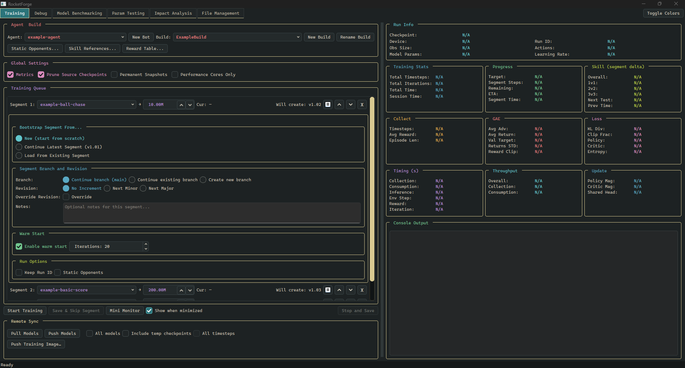

# RocketForge

RocketForge is a user friendly C++ architecture for training ML Rocket League bots.



## What makes it user friendly

### An optional GUI
Makes what used to be tedious tasks as simple as pressing some buttons:
* [Specifying what to train](Documentation/Features/TrainingStages.md), and training multiple stages in a row
* File management
  * Includes a [build/segment/version system](Documentation/Concepts/ModelVersioning.md) for organizing each run
  * Each segment can have its own attached notes
* [Exporting to RLBot and making submission packages](Documentation/Features/RLBot.md)
* [Visual debugging](ForgeTraining/ForgeDebugger/RocketSimVis/README.md)
* [Skill benchmarking](Documentation/Features/ModelBenchmarking.md) against other bots
* Testing a variety of different training parameters against each other
* [Remote training with a Docker image](Documentation/RemoteTraining/RemoteTraining.md)
* [Analyzing the rewards](Documentation/CLI/ConsoleTrainer.md#reward-analysis) of a stage and how they impact a specific model

### Easy to build on
* Your bots live in [their own self registered folder](Documentation/AddingABot.md)
  * No need to modify the core codebase to add your own bot or custom logic such as [rewards](Documentation/Features/Rewards.md)
* New ways of defining rewards to cleanly split them into parts, and separate continuous vs event
* Flexible options on how to train
* We plan on making the learner more modular in the future to support a variety of different training methods
* Codebase has lots of comments and some [documentation](Documentation/README.md)
* Full unit test framework to make sure you don't accidentally break something when modifying the codebase
* Pre-setup [build configurations](CMakePresets.json) to make building different exe's easy
* Most functionality is accessible via [CLI](Documentation/CLI/ConsoleTrainer.md) with custom arguments, so if desired LLMs can easily interface with RocketForge

### Easy setup
* We provide [scripts for installing most needed tools](#windows-quick-start)
* [Documentation to help with creating your first bot](Documentation/GettingStarted.md)
  * Along with [a tool to do the boilerplate for you](Documentation/AddingABot.md) with an example setup
* GUI is optional for those who don't want it or can't support it
* [Supports CPU only](Documentation/Features/CpuOnly.md) for those without CUDA
* [Linux](#linux) supports console training only, and is untested outside the Docker image
  * Sorry! Please help us fix this if you find issues

## Agents and Training Stages

As part of an effort to make the architecture modular and user friendly, as well as reduce the size of the RLBot exe,
we've set up these two concepts to split the bot into what is needed for inferring and what is needed for training.

### The agent
Each bot declares an agent that defines everything that would be needed to create and infer the policy.
This is the shared interface between training and inference logic such as RLBot, benchmarks, static opponents, etc.
Part of the beauty of this approach is that it allows for sharing your bot with others without giving away the methods used for training.

### The training stage
A [training stage](Documentation/Features/TrainingStages.md) is what defines how an agent learns: everything from rewards, state setters, which learning algorithm to use and its configs, etc.
Typically, a bot has a "Training Plan" that has a parent stage for the overall training settings,
then multiple child stages, each for a different stage of learning.
The example agent has examples such as a ball-chase and a basic score stage.
Although these stages are typically specific to a bot, there is nothing stopping a training stage from one agent being used to train a different agent,
except for things such as the team sizes a stage trains.

## The Learner
Currently RocketForge uses a modified version of [GigaLearn](https://github.com/ZealanL/GigaLearnCPP-Leak). It includes some fixes, optimizations, and minor additions such as
return normalization, advantage normalization, a proto [PPG](Documentation/Concepts/PPGAlgorithm.md) implementation,
an experimental "decomposed" critic implementation (one value head per reward), a sine-wave schedule for the entropy scale,
[adaptive reward weights](Documentation/Features/AdaptiveRewardWeights.md), and [transfer learning](Documentation/Features/TransferLearning.md) between different architectures.

Compared to other frameworks and what people in the community are currently using to make good bots, the learner here is a bit lacking and outdated. Part of our next steps is to improve that.

## Requirements

### Windows

Windows 10 or 11, 64-bit, is the main platform and the only one that runs the GUI and the RLBot exe.

* Visual Studio 2022 or its Build Tools, with the C++ workload
* Python 3.9-3.12
* libtorch 2.13.0
* Git
* Optional:
  * An NVIDIA GPU and the CUDA 12.6 toolkit (without them, training runs on the [CPU](Documentation/Features/CpuOnly.md))
  * Qt 6.10.2, for the GUI
  * Rust 1.95 or later, for RocketSim v3 (see [Simulation engines](Documentation/Features/SimulationEngines.md))
  * Rocket League and [RLBot v5](https://rlbot.org/), to play your bot in game

The [setup scripts below](#windows-quick-start) install everything except Git, CUDA and Rocket League.

### Linux

Linux builds the console trainer and the tests, with the `forge-console-linux` preset and `tools/build/build_and_test.sh`.
That's enough to train, but there's no GUI or RLBot exe, and it has only been tested inside the [Docker training image](Documentation/RemoteTraining/RemoteTraining.md).
It needs gcc 11 or later, CMake, Ninja, python3-dev, the CUDA 12.9 toolkit and libtorch 2.13.0+cu129 at `/opt/libtorch`
(see the top of `build_and_test.sh`; Rust is optional, through `tools/setup/install_rust.sh`).

## Installation

### Windows quick start

Clone the repository with its submodules:

```bash
git clone --recursive https://github.com/DevQuaxalotl/RocketForge.git
```

A clone without `--recursive` still builds: the CMake configure fetches the missing submodules.

Run the scripts from the repository root.
Each one checks for an existing install first and asks before installing anything.

1. **C++ compiler:** `powershell -ExecutionPolicy Bypass -File .\tools\setup\install_build_tools.ps1`
   installs Build Tools for Visual Studio 2022 with the C++ workload (compiler, CMake and Ninja, no IDE).
   Any VS2022 edition that already has the "Desktop development with C++" workload works instead.
2. **Python:** `powershell -ExecutionPolicy Bypass -File .\tools\setup\install_python.ps1`
   installs Python 3.12 for the current user (no administrator rights) and `wandb` for training metrics.
   The build embeds Python, so the configure fails without it; any Python 3.9-3.12 on PATH works instead.
   Open a new terminal afterwards so PATH includes it, and run `wandb login` once, or train with `--no-metrics`.
3. **CUDA (NVIDIA GPU only):** install the [CUDA 12.6 toolkit](https://developer.nvidia.com/cuda-12-6-0-download-archive).
   Without an NVIDIA GPU, skip this step; the next one installs the CPU build of libtorch and training runs on the CPU.
4. **libtorch:** `powershell -ExecutionPolicy Bypass -File .\tools\setup\install_libtorch.ps1`
   installs libtorch 2.13.0 to `%LOCALAPPDATA%\libtorch` (the configure fails without it).
   With an NVIDIA GPU it installs the CUDA 12.6 build (a 5.2 GB download, 7.7 GB installed);
   without one, the CPU build (a 0.2 GB download). `-Variant Cpu` or `-Variant Cuda` overrides the choice.
   To install by hand, extract
   [the CUDA build](https://download.pytorch.org/libtorch/cu126/libtorch-win-shared-with-deps-2.13.0%2Bcu126.zip)
   or [the CPU build](https://download.pytorch.org/libtorch/cpu/libtorch-win-shared-with-deps-2.13.0%2Bcpu.zip)
   so that its `libtorch` folder sits at `%LOCALAPPDATA%\libtorch` (the folder holding `share\cmake\Torch`).
   For any other folder, pass `-DLIBTORCH_ROOT=<path>` when configuring.
5. **Qt (GUI only):** `powershell -ExecutionPolicy Bypass -File .\tools\setup\install_qt.ps1`
   installs the Qt 6.10.2 modules the GUI uses to `C:\Qt` (about 430 MB; needs Python 3.9 or later).
   With `-OutputDir <folder>`, set `QTDIR` to the printed path; the CMake configure reads it.
   Without Qt, the `forge` preset still builds the console trainer and the tests, and skips the GUI.
6. **Rust (optional, RocketSim v3):** `powershell -ExecutionPolicy Bypass -File .\tools\setup\install_rust.ps1`
7. **Build:** `powershell -ExecutionPolicy Bypass -File .\tools\build\build_and_test.ps1 -BuildGui`
   builds and tests everything, including ForgeGUI.

Other compilers aren't scripted.
CUDA on Windows compiles through MSVC, and the prebuilt libtorch and Qt binaries are MSVC builds,
so any other toolchain needs MSVC's compiler or libraries underneath it.

For a full walkthrough, from a fresh clone to watching your first trained bot, see [Getting started](Documentation/GettingStarted.md).

### Adding a bot

Press **New Bot** in the GUI's Training tab, or run `ForgeConsoleTrainer create-bot <Name>`, then re-configure and rebuild.
See [Adding a bot](Documentation/AddingABot.md).
To bring in an existing model from a different framework, the **Import Model...** button in the File Management tab
can be used to cleanly bring in a model from anywhere (the CLI can't import models yet).
See [Importing models](Documentation/Features/ImportingModels.md).

### Configuring training
Once your agent's training stages are set up, all you need to do to configure training is set what you
want trained in the GUI's Training tab or the settings file, then start training!
If using the CLI instead of the GUI, see [Settings files](Documentation/CLI/SettingsFiles.md) for more info on how to set settings.

### Playing in Rocket League (RLBot)
RocketForge allows for easy export to RLBot once a model has been trained in the framework.
Just build the RLBot exe, run the export command on a segment, and make sure RLBot is looking at that agent's `rlbot_exports` folder.
See [RLBot](Documentation/Features/RLBot.md).

### Documentation index
For more details on specific features, see the [documentation index](Documentation/README.md).

### Contributing
RocketForge is open source, and we encourage people to submit PRs for changes they want or create forks.
We ask that you follow the [coding standards](Documentation/CodeStandards.md).
The standards were written to ensure any AI agents touching the codebase can generate code that is easy to read and professional grade,
without you needing to nitpick specifics or do cleanup yourself. If you do use AI to modify the codebase,
we recommend having a hard rule for agents to always read these standards before writing code.

Once code has been added, you can use `tools/build/build_and_test.ps1` to confirm things build and pass all tests.

Issues or requests can be submitted via [GitHub](https://github.com/DevQuaxalotl/RocketForge/issues).

## License

RocketForge is released under the [MIT License](LICENSE).
Third-party components keep their own licenses; see [THIRD_PARTY_NOTICES.md](THIRD_PARTY_NOTICES.md).
The bundled Necto and Nexto bots are licensed under CC BY-NC-SA 4.0,
so anything built on them is for non-commercial use only; see [Bots/PublicBots/README.md](Bots/PublicBots/README.md).

## Acknowledgements

RocketForge builds on the work of others. Thank you to:
* Lucas Emery, Aech, and everyone else who worked on [RLGym](https://rlgym.org), the Python framework RLGymCPP is based on
* ZealanL, for GigaLearnCPP, RLGymCPP, RocketSim v2 and RocketSimVis
* Virx, for RocketSim v3 and RLBot v5
* EastVillage, for RLBot v5

Everyone else whose work is included is credited in [THIRD_PARTY_NOTICES.md](THIRD_PARTY_NOTICES.md).
